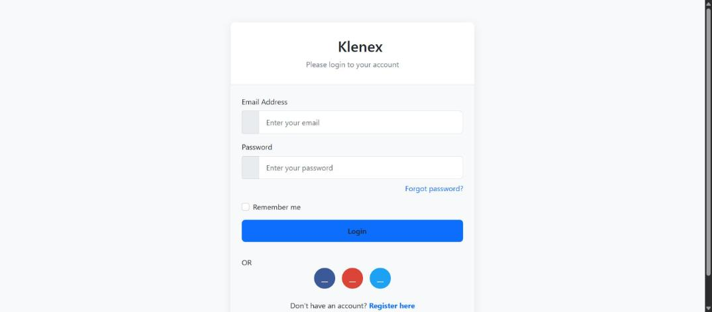
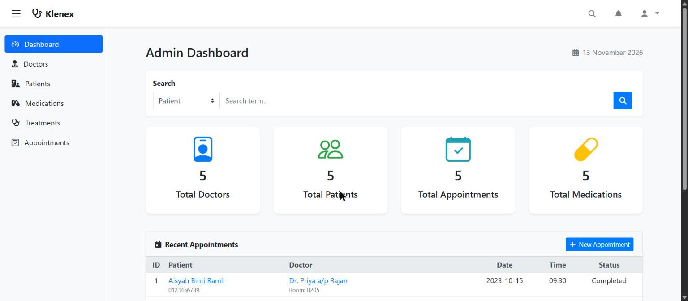
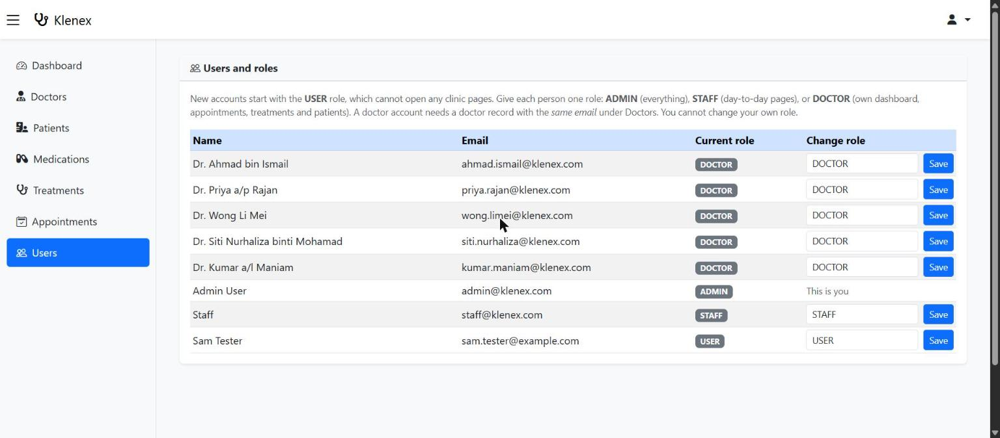
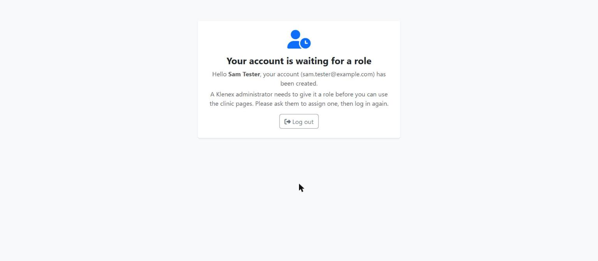
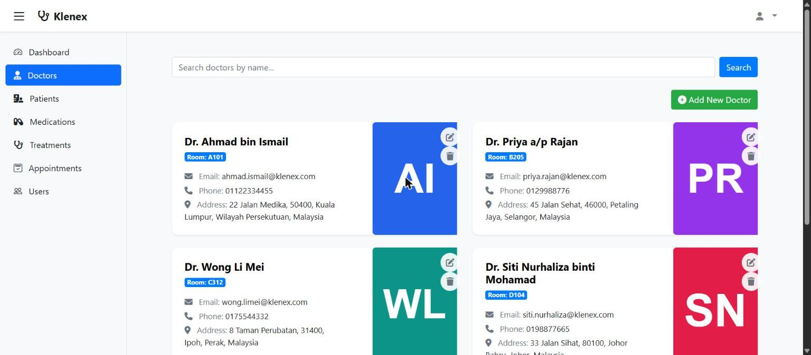
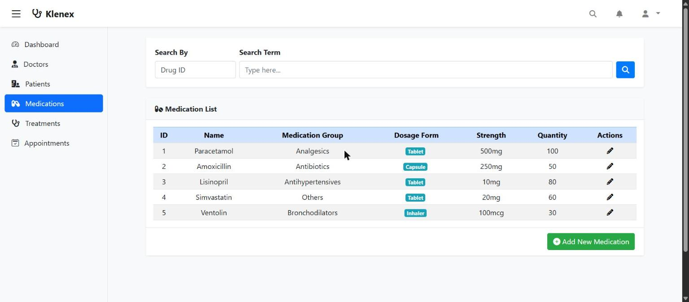
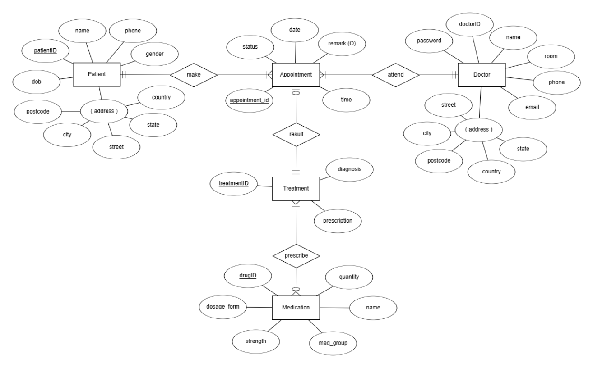

# Klenex: Clinic Management System

[](https://github.com/asteraaaaa/csc3402-klenex/actions/workflows/ci.yml)
[](LICENSE)


A Spring Boot web application for running a small clinic: doctors, patients, appointments, treatments and
medication stock, with role-based login for admins, staff and doctors.

It is an academic group project for **CSC3402**. **It is not for clinical use.**

| Login | Admin dashboard |
|---|---|
|  |  |

## Features

- **Role-based login** with four roles: admin, staff, doctor, and a plain user that has not been given a role yet
- **Registration**: anyone can create an account; it waits on a "waiting for a role" page until an admin
  assigns a role from the **Users** screen
- **Admin / staff area**: dashboard with totals and recent appointments, and management of patients,
  medications (stock), treatments and appointments; staff can look at the doctor list, admins can also
  add, edit and delete doctors
- **Users and roles** (admins only): see every account and give each person one role
- **Doctor area**: each doctor gets their own dashboard (today's appointments, pending treatments and
  medications, patients seen), plus their appointments, patients and treatments. **A doctor can only
  open their own records**, never another doctor's
- **Treatments** link an appointment to a diagnosis, a prescription and the medications prescribed
- **Security basics**: BCrypt-hashed passwords, CSRF protection on every form, logout that really ends the
  session, and every delete is a POST with a CSRF token (no delete links)

| Users and roles (admin) | Waiting for a role |
|---|---|
|  |  |





## Quick start

You need **JDK 17 or newer** (`JAVA_HOME` must point to it). Maven is included via the wrapper.

```bash
git clone https://github.com/asteraaaaa/csc3402-klenex.git
cd csc3402-klenex
./mvnw spring-boot:run        # macOS / Linux
.\mvnw.cmd spring-boot:run    # Windows (PowerShell or cmd)
```

Open <http://localhost:8080> and log in with one of the demo accounts below.

The app uses an in-memory H2 database that is filled from `src/main/resources/data.sql` on every start,
so **all data resets when you stop it**.

### Demo accounts

All demo accounts use the same password: **`KlenexDemo#2025`**

| Email | Role | Lands on |
|---|---|---|
| `admin@klenex.com` | Admin | Admin dashboard |
| `staff@klenex.com` | Staff | Admin dashboard |
| `ahmad.ismail@klenex.com` | Doctor | That doctor's dashboard |

The other doctors are `priya.rajan`, `wong.limei`, `siti.nurhaliza` and `kumar.maniam`, all `@klenex.com`.

The password is public on purpose, for demos only, and it exists only as a BCrypt hash in `data.sql`.
**Change it (or remove these accounts) before using the app for anything real.** All patients, doctors
and records in the demo data are fictional.

### Run the tests

```bash
./mvnw verify
```

## Roles: who can open what

| Page | Admin | Staff | Doctor | New account (USER) |
|---|:-:|:-:|:-:|:-:|
| `/admin` dashboard, `/medication` | yes | yes | no | no |
| `/doctor` (doctor list) | yes | yes | no | no |
| Add, edit, delete doctors (`/doctor/...`) | yes | no | no | no |
| `/admin/users` (assign roles) | yes | no | no | no |
| Open appointments, patients and treatments | all | all | **own only** | no |
| Edit a treatment, delete a treatment | all | all | **own only** | no |
| Add, edit or delete appointments and patients, add treatments | yes | yes | no | no |
| `/doctors` (own dashboard) | no | no | yes | no |
| `/pending` (waiting for a role) | any logged-in account without a working role | | | |

A page your role cannot open shows an **Access denied** page (HTTP 403). The rules live in
[`SpringSecurity.java`](src/main/java/com/klenex/health/klenex/config/SpringSecurity.java).

### What "own" means for a doctor

The URL rules above decide which *roles* may open a page; [`AccessPolicy`](src/main/java/com/klenex/health/klenex/service/AccessPolicy.java)
then checks the individual record. A doctor may open:

- an **appointment** that is assigned to them,
- the **treatment** of one of those appointments, and
- a **patient** they have an appointment with.

Anything else is refused with the Access denied page, even if the doctor types the address by hand.
When a doctor edits a treatment, the appointment it belongs to cannot be changed through the form.

### Giving a new account a role

1. Someone registers on `/registration` and logs in. They see "Your account is waiting for a role".
2. An admin opens **Users** in the sidebar, picks a role for that account and presses **Save**.
3. The person logs in again and lands on the right dashboard.

Rules the Users screen enforces: each person has exactly one role, an admin **cannot change their own
role** (so the system can never end up with no admin), and the **Doctor** role needs a doctor record with
the *same email* under Doctors (the account is linked to it), otherwise the change is refused.

## Database design

The entity-relationship diagram is [`doc/Klenex.png`](doc/Klenex.png). More design material is in
[`erd.md`](erd.md) and [`wireframe.md`](wireframe.md).



## Project layout

```
src/main/java/com/klenex/health/klenex/
  config/        Spring Security (roles, login, logout)
  controller/    pages for dashboard, users, doctors, patients, appointments, treatments, medication, login
  service/       business logic, role assignment and the login user lookup
  repository/    Spring Data JPA repositories
  model/         JPA entities (User, Role, Doctor, Patient, Appointment, Treatment, Medication)
  dto/           registration form object
src/main/resources/
  templates/     Thymeleaf pages (admin, doctor, patient, appointment, ...)
  static/        CSS, JS and doctor avatar images
  data.sql       demo data and accounts
src/test/        58 integration tests (MockMvc)
```

**Tech:** Java 17, Spring Boot 3.4 (Web, Data JPA, Security, Validation, Thymeleaf, Actuator), H2, Bootstrap from a CDN.

Doctor pictures are simple generated avatars (initials on a colour); a doctor without one gets a default avatar.

## Known limitations

This is a student prototype:

- There is **no password reset**; an admin would have to change the database.
- Deleting a treatment, or anything else, shows no confirmation banner afterwards; the list simply updates.
- Two unused page templates (`list-doctor.html`, `choose-doctor-to-delete.html`) are left over from an
  earlier design and point to addresses that do not exist.
- The data is in memory and resets on restart.
- The H2 database console is **off** by default. If you turn it on for debugging
  (`spring.h2.console.enabled=true`), only a logged-in admin can open it. Never enable it on a server
  other people can reach.
- Bootstrap is loaded from a CDN, so the pages need an internet connection.

## License

[MIT](LICENSE)
